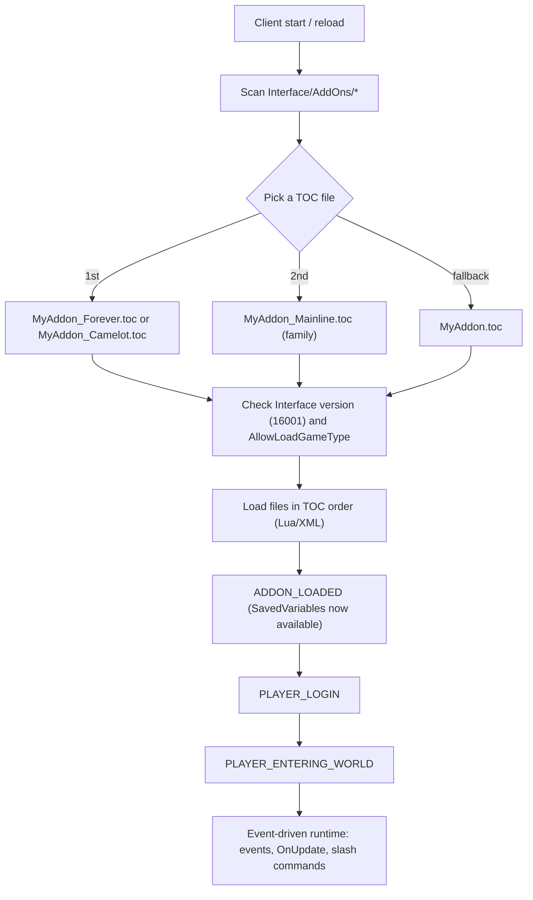

# WoW: Forever — Addon Development Research Notes

*Researched 2026-10-19. Forever is in **Beta 5 (1.60.1, build 70425)**, and launch is scheduled for **Nov 4, 2026**. Expect more API changes before then.*

## 1. The key insight: Forever is "Mainline", not "Classic"

From Blizzard's blue post *"An Update On Secrets In WoW: Forever"* (2026-09-15):

> WoW Forever shares Mainline WoW's UI architecture, including the vast majority of APIs available in 12.1.5. [...] Forever and modern WoW (Midnight) are two game types within the Mainline code family: **Camelot** and **Standard**, respectively.
> The addon disarmament changes introduced in Midnight, **including secrets, will also be active in Forever.**

What this means for you:
- Forever looks like Vanilla, but under the hood it runs the **retail (Midnight 12.1.5) API**. Use the modern namespaced APIs (`C_Spell.*`, `C_Item.*`, `C_AddOns.*`, …). Old Classic-era globals are gone.
- **Classic Era addons (1.15.x) will not just work.** Retail addons are much closer, but some APIs work differently (Forever adds things like `C_PetInfo.GetPetHappiness`, `C_SkillInfo.*`, `C_QuestLog.GetQuestTimers`, ammo, stable slots, and removes about 10 APIs).
- Docs to use: the **retail** pages on [warcraft.wiki.gg](https://warcraft.wiki.gg/wiki/World_of_Warcraft_API), plus [Patch 1.60.1/API changes](https://warcraft.wiki.gg/wiki/Patch_1.60.1/API_changes) for what's specific to Forever.

## 2. Load flow (how the client finds and runs your addon)



## 3. TOC file essentials

| Item | Value for Forever |
|---|---|
| `## Interface:` | **`16001`** (Beta/Test). Multi-client example: `## Interface: 120105, 16001` |
| Game type | `camelot`, with `forever` as an alias (added in Beta 4). Blizzard says `camelot` will be renamed before launch |
| Family | `mainline` (includes `standard`, `forever`/`camelot`, …) |
| TOC suffixes | `_Forever.toc` / `_Camelot.toc`, then `_Mainline.toc`, then plain `.toc` |
| Lua check | `WOW_PROJECT_ID == WOW_PROJECT_CAMELOT` (value 18) |

**Forever-only addon** (per the wiki). You need the exclude line because Standard and Classic clients don't recognize `forever` yet, and unrecognized game types still load:
```
## AllowLoadGameType: forever
## ExcludeLoadGameType: standard, classic
```

Per-file / per-directive inline conditions also work:
```
ForeverOnly.lua [AllowLoadGameType forever][ExcludeLoadGameType standard, classic]
```

## 4. Restrictions you will run into (secret values / "addon disarmament")

Starting in 12.0 (and also in Forever), many combat APIs return **secret values** when called from addon (tainted) code under certain conditions: combat, encounters, PvP matches, or restricted maps such as dungeons and raids.

With a secret value, your code **can**:
- store it, pass it to functions, concatenate/`string.format` it
- feed it to widget APIs that accept secrets (e.g. `StatusBar:SetValue`, `FontString:SetText`)

Your code **cannot** (it causes an immediate Lua error):
- do arithmetic, comparisons, or boolean tests on it
- use `#`, use it as a table key, index it, or call it

Helpers: `issecretvalue(v)`, `canaccessvalue(v)`, `issecrettable(t)`, `canaccesstable(t)`, plus the `C_RestrictedActions` and `C_Secrets` namespaces.

Examples: `UnitHealth`, enemy cast info, auras, cooldowns, threat values, and `UnitName` on non-party units in combat can all be secret depending on context.

Recent Forever-specific security changes:
- Creature/GameObject GUIDs have obfuscated server/spawn IDs, so you can't use them to detect layers (Beta 5).
- `SendChatMessage("EMOTE")` needs a hardware event outside instances. Trial accounts can't send addon messages (Beta 4).
- Player/target/pet/ToT/focus frames and the minimap header were reskinned. Addons that anchor to them may break (Beta 5).

**Design rule of thumb:** UI, quality-of-life, bags, map, questing, professions, AH, social, and collection addons are a good fit. Combat-logic addons (rotation helpers, threat math, WeakAuras-style conditional alerts) are heavily limited by design.

## 5. Dev loop

1. Put the addon folder in the Forever client's `Interface\AddOns\`. The folder name **must match** the TOC name.
   - **Confirmed local install:** `C:\Program Files (x86)\World of Warcraft\_classic_beta_\Interface\AddOns\` (product `wow_classic_beta`, exe `WowB.exe`, build **1.60.1.70450**). The folder is writable, and no addons are installed yet.
   - Recommended: keep your source in a project folder and create a **directory junction** into `AddOns` (`mklink /J`), so git and your editor work outside Program Files.
2. Edit in VS Code with **Ketho's "WoW API" extension** (LuaLS annotations and autocomplete).
3. In game: `/reload` picks up Lua/XML and TOC changes. New TOC *files* or renames need a full restart.
4. Debugging: `/console scriptErrors 1`, **BugGrabber + BugSack**, `/dump expr`, `/fstack` (frame inspector), `/etrace` (event trace), `/tinspect`.
5. Reference Blizzard's own UI code: [wow-ui-source](https://github.com/Gethe/wow-ui-source) (the Forever diffs are linked from the wiki).
6. Publish on CurseForge / Wago with the 16001 interface tag.

## 6. Minimal skeleton

`MyAddon/MyAddon.toc`
```
## Interface: 16001
## Title: MyAddon
## Notes: Hello Forever
## Author: You
## Version: 0.1.0
## SavedVariables: MyAddonDB
## IconTexture: Interface\Icons\INV_Misc_QuestionMark

Core.lua
```

`MyAddon/Core.lua`
```lua
local addonName, ns = ...
local f = CreateFrame("Frame")

f:RegisterEvent("ADDON_LOADED")
f:RegisterEvent("PLAYER_LOGIN")

f:SetScript("OnEvent", function(self, event, arg1)
    if event == "ADDON_LOADED" and arg1 == addonName then
        MyAddonDB = MyAddonDB or { count = 0 }   -- SavedVariables ready here
        self:UnregisterEvent("ADDON_LOADED")
    elseif event == "PLAYER_LOGIN" then
        MyAddonDB.count = MyAddonDB.count + 1
        print(("|cff33ff99%s|r loaded (login #%d) on project %d"):format(
            addonName, MyAddonDB.count, WOW_PROJECT_ID))
    end
end)

SLASH_MYADDON1 = "/myaddon"
SlashCmdList.MYADDON = function(msg)
    print("MyAddon:", msg)
end
```

## Sources
- [TOC format — warcraft.wiki.gg](https://warcraft.wiki.gg/wiki/TOC_format)
- [Patch 1.60.1/API changes — warcraft.wiki.gg](https://warcraft.wiki.gg/wiki/Patch_1.60.1/API_changes) (includes Blizzard blue posts from Sep 15, Oct 8, and Oct 16)
- [Secret Values — warcraft.wiki.gg](https://warcraft.wiki.gg/wiki/Secret_Values)
