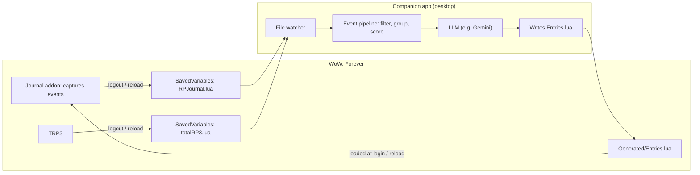

# RP Journal (TRP3 companion): Ideation

## 0. The hard constraint that shapes everything

**WoW addons can't access the network.** Lua in the client can't make HTTP calls, so the addon itself can't call an LLM. The only ways data leaves the game are files the client writes to disk (SavedVariables, which are written on `/reload`, logout, or exit).

So this must be a **two-part system**:

- There's a well-known precedent: the **TSM Desktop App** writes data into its `TradeSkillMaster_AppHelper` addon folder, and the addon reads it at load. We'd do the same thing.
- **The companion must never write to SavedVariables while the game is running.** The client overwrites them on logout. It should write its own `.lua` data file inside the addon folder instead. Editing an existing file is picked up by `/reload`; a brand-new file needs a full restart, so we ship an empty placeholder file.
- **Turn the delay into a theme:** *"Your character writes in their journal when they rest."* Logging out at an inn, or a `/reload`, triggers a new entry. Entries appear the next time you open the journal.
- An **offline fallback** (template-based entries made in game, no LLM) is worth having, so the addon is never empty.

## 1. What we can capture on Forever (no combat data needed)

The combat restrictions mostly don't hurt us. A journal is about story, not DPS. The raw combat log is restricted in Midnight and therefore in Forever, so **don't depend on kill tracking**. Quest objectives cover that.

| Source | Events / APIs | Story value |
|---|---|---|
| Quests | `QUEST_ACCEPTED`, `QUEST_TURNED_IN`, `QUEST_DETAIL`/`QUEST_COMPLETE` + `GetQuestText()`, `GetObjectiveText()`, `GetRewardText()`, the quest-line APIs | ⭐ The quest's **flavor text** is full story context for the LLM |
| Places | `ZONE_CHANGED_NEW_AREA`, subzone, first visit to a zone, `PLAYER_UPDATE_RESTING` (inns) | Setting, "arrived at…" |
| Travel | Flight paths (`UnitOnTaxi`, taxi events), boats/zeppelins, hearthstone casts, continent changes | Makes zone jumps believable |
| Growth | `PLAYER_LEVEL_UP`, new spells, profession skill-ups, reputation tiers | Milestones |
| Hardship | `PLAYER_DEAD`, spirit healer, durability loss | Drama |
| Social | Group joins, dungeon completion, guild events | Companions |
| RP | The player's own `/e` emotes, TRP3 "Currently" status changes, a manual `/journal note …` | ⭐ The player's own words |
| Loot | Epic or rare items, quest rewards | Trophies |

## 2. Reading TRP3

Two options, ideally both:
1. **Companion reads `totalRP3.lua` from SavedVariables directly.** This gives the full profile: name, title, race/class text, age, "About" free text, personality traits (sliders), "Currently"/OOC info, and so on. Field names need to be confirmed by inspecting a real file.
2. **The addon reads it at runtime** via `TRP3_API` and stores a **snapshot** with each session. That way the journal sees how the character changed over time ("she no longer calls herself a coward…").

**Making it personal:** during setup (once per profile, and again when it changes), the LLM extracts a **Character Brief**:
- voice and tone (formal noble? superstitious farmer? terse soldier?)
- fears, loves, hates, goals, and important people
- **keyword hooks** for matching: `boars`, `water`, `undead`, `Stormwind`, `brother Aldric`…

Each event is then matched against these hooks. In your example, *"Kill 10 Rockhide Boars"* plus the fear `boars` makes that quest important and picks the angle "facing her fear".

> [!WARNING]
> I couldn't confirm that TRP3 is available on Forever yet (search results said no official port, but that isn't reliable). Since Forever runs the retail API, the retail TRP3 may just work. **Please check whether TRP3 loads on your beta client.** This could block the whole idea.

## 3. Not logging every quest: significance scoring

Every captured event gets a **score**. Only high scorers become journal moments; the rest collapse into a short summary or are dropped.

| Signal | Weight (example) |
|---|---|
| Matches a Character Brief hook (fear, goal, hometown, enemy faction) | +++ |
| Last quest of a quest chain / the quest-line's finale | +++ |
| Player wrote a `/journal note` or an emote during it | +++ |
| Death, dungeon clear, elite or group quest | ++ |
| First visit to a zone, level milestone (10/20/…/60), reputation tier | ++ |
| Long flavor text (Blizzard put story there) | + |
| Simple "kill 10 / collect 8" with no hook | − |
| Repeatable / daily quest | −− |

Then **collapse the low scorers**: "*Spent most of the week doing odd jobs for the farmers of Westfall — mostly honest work, if muddy.*" One sentence covers 12 filler quests.

**Player curation** (which also feeds the scoring next time):
- ⭐ Star / 🚫 hide a moment in the journal UI
- 🔁 "Rewrite this entry" (queued for the companion)
- Per-character "verbosity" setting: *Terse / Balanced / Chronicler*

## 4. Not reading like nonsense: narrative coherence

Your Westfall → Darkshore problem. Approaches that combine well:

### a) Threads, not a timeline
Group events into **threads**: one per quest-line or zone story ("The Defias Brotherhood", "Troubles in Darkshore"). The journal writes **one entry per thread when something meaningful happens**, not in strict real-time order. Interleaved play becomes separate, clean storylines.

### b) In-character time ≠ real time
Keep an **in-world calendar**. Travel moves it forward according to distance:
- same zone: same day
- neighboring zone: "the next morning"
- other continent: **days or weeks pass** ("*The voyage from Menethil took the better part of a week…*")
- hearthstone home: "*returned to Goldshire to rest*"

Journal dates become *"Day 14 — 3rd week of Spring"*, never "Oct 19, 17:08".

### c) Travel as a scene, not a jump
When a continent change or a long flight is detected, the companion inserts a short **travel passage** or a **time-skip line**. Moving between zones then becomes part of the story.

### d) Motivation bridging
When jumping to an unrelated thread, the LLM gets the previous thread and the new quest's flavor text and writes the **why**: "*A letter from the Sentinels had been waiting for weeks; Westfall would have to manage without me.*"

### e) Chapters
Bigger structure: a **chapter** = a level band and region ("Chapter II — The Elwynn Days, levels 5–12"). Each chapter gets an LLM-written title and a short summary when it closes. This keeps the journal readable after 200 hours.

### f) Consistency memory
The companion keeps a **story memory** (who was met, promises made, injuries, unresolved threads). Each new entry is written with that context, so names and facts stay consistent.

## 5. In-game UI ideas
- An old-book frame (parchment, page flip), opened via the minimap or the TRP3 toolbar button if TRP3 has an extension point for that.
- Tabs: **Journal** (chapters → entries), **Threads**, **Notes**.
- Each entry shows a small map/zone pin and a "real date" tooltip (OOC).
- Optional: **share an entry** into TRP3's "About" or "Currently" fields, or via chat link, so other RPers see it.

## 6. Tech sketch
- **Addon (Lua):** event capture → buffered "session log" in SavedVariables; journal reader UI; reads `Generated/Entries.lua`.
- **Companion (TypeScript, which fits your Next.js experience):** Node or Electron/Tauri tray app. File watcher on `WTF/Account/*/SavedVariables/`, a Lua table parser, the pipeline (filter → threads → score → in-world time), Gemini API calls, and a Lua serializer for the output.
- **Model use:** small/cheap model for the per-event Character Brief matching and scoring; a stronger model for writing entries and chapter summaries.

## 7. Open questions for you
1. **Companion app OK?** It's the only way to use an LLM. Are you fine asking users to install a desktop app plus an API key, or should the in-game template fallback be the main experience?
2. **Narrator voice:** always first-person "the character writes", or let the user choose (1st person / 3rd-person chronicler / letters home)?
3. **When entries are written:** on every logout/reload, or only when "resting" (logging out at an inn, or a manual `/journal write`)?
4. **Scope of v1:** quests + travel + TRP3 brief + chapters? Or include social/RP capture (emotes, party members) from the start?
5. **Other players' data:** using party members' names or TRP3 profiles in your journal raises privacy questions. Include, make opt-in, or skip?
6. **Is TRP3 installable on your Forever beta?** (see the warning in §2)
