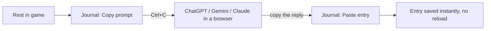

# Can Quill & Hearth work without a companion app?

## The hard limit
A WoW addon **cannot** make network requests, launch programs, or read/write files (except SavedVariables, which the game writes on logout/reload). Running a real LLM *inside* WoW Lua isn't feasible either: the script time limits ("script ran too long") and memory rule out anything beyond a toy Markov chain, and those read as gibberish.

So **either the text is written outside the game, or the text isn't written by a live LLM**. Within that limit, there are four ways to drop the separate app.

---

## Option A: Copy-paste bridge (no install, any LLM)
The addon builds the prompt itself and the player moves it by hand, the same way WeakAuras import/export strings work.

- ✅ Zero install, no API key. It works with **any** chat LLM, including free tiers, and the player picks the provider (good for privacy).
- ✅ The entry appears instantly. Pasting into an in-game EditBox needs no reload.
- ✅ Easy to build: the threads/calendar/scoring logic moves from TypeScript to Lua; the prompt is just text.
- ❌ Manual: alt-tab, two copies, one paste per rest. Some players will love it as a ritual, others won't bother.
- ❌ The reply quality depends on whatever LLM they use; we ask for a simple text format and handle messy pastes.

## Option B: A web page instead of an app (no install, browser tab)
Host the companion as a static page (e.g. GitHub Pages, like your other projects). Chrome/Edge's **File System Access API** lets a page get read/write access to a folder the user picks. Since Chrome 120 that permission **can persist across visits**. The page can then watch `SavedVariables` and write `Entries.lua`, doing exactly what the companion does today.

- ✅ Nothing to install; open a bookmark before playing. The code is fully visible.
- ✅ Two LLM choices:
  - the user's own Gemini key, stored only in their browser, or
  - **Chrome's built-in on-device Gemini Nano** (Prompt API): free, private, no key. Caveat: it has been stable for *extensions* since Chrome 138, but for normal *web pages* it's still rolling out (origin trial, targeted stable around Chrome 148). It needs a capable PC (~22 GB free disk), and Nano writes noticeably worse than Gemini Flash.
- ❌ Chrome/Edge only (Firefox/Safari lack this API), and the tab must stay open while playing.
- ❌ Still a reload to see entries (same as now), and still "a second thing to run", just lighter.

## Option C: No live LLM, written in game (no app at all)
### C1: Template writer in Lua
Hand-written sentence templates × character voice (from onboarding traits) × event data (quest titles, zones, deaths, travel), plus the same scoring, threads and calendar logic, all in Lua.
- ✅ Zero setup; entries appear **the moment you rest**, with no reload.
- ❌ Gets repetitive fast; it can't retell quest stories or weave in a TRP3 backstory. Mostly "I travelled to X, helped Y, nearly died to Z."

### C2: "LLM at build time": a pre-written library
Use the LLM **while building the addon**, not while playing. For every quest we have text for, pre-generate short first-person snippets in a few voices (stoic, cheerful, brooding, scholarly, …), tagged with themes (`boar`, `undead`, `water`…). Ship them as a data file; in game, Lua picks the right voice, matches fears/goals via tags, and stitches snippets together with travel and day transitions.
- ✅ Zero setup, instant, offline, and real story flavor per quest.
- ✅ Fear/goal matching still works through the tags (your boar example).
- ❌ Less personal: it can't write about a specific TRP3 backstory or remember people met.
- ❌ Needs quest text for Forever's ~1,000 new quests (datamining, or collected from players' own captures), and an addon update whenever content is added.
- ❌ Size: roughly 4,000 quests × 4 voices × 2 snippets × ~250 bytes ≈ **8 MB** (rough estimate). That's in the same range as big database addons like Questie, so it's acceptable.

---

## Comparison
| | Install | Setup | Writing quality | Personal (TRP3, memory) | Entry appears | Effort to build |
|---|---|---|---|---|---|---|
| **Current companion** | Node app | API key | ★★★★★ | ★★★★★ | after reload | done |
| **A. Copy-paste** | none | none | ★★★★ (their LLM) | ★★★★ | instantly | small |
| **B. Web page** | none | pick folder + key | ★★★★★ (key) / ★★★ (Nano) | ★★★★★ | after reload | medium |
| **C1. Templates** | none | none | ★★ | ★ | instantly | medium |
| **C2. Pre-written library** | none | none | ★★★ | ★★ | instantly | large (+ data upkeep) |

## Recommendation: tiered
1. **Default, works for everyone: C1 now, grown into C2 later.** Every player gets a journal that writes itself the moment they rest, with no setup.
2. **"Write it with AI" upgrade: A (copy-paste).** One button turns tonight's entry into a rich, personal LLM-written one, with no install and their choice of LLM.
3. **The current companion becomes optional** (or is replaced by B later) for players who want it fully automatic.

That removes the separate app from the default experience, keeps the rich writing for anyone willing to do a copy-paste, and fixes the "wait for the ink to dry, then reload" problem for most players.
