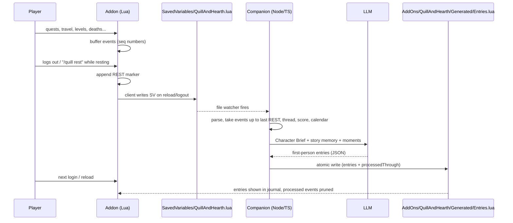

# Quill & Hearth v1: Implementation Plan

An automatic, first-person RP journal for WoW: Forever. An in-game addon records meaningful moments. A desktop companion app turns them into journal entries with an LLM, but only when the character **rests**. Entries appear in a book-style UI in game.

Builds on [IDEATION.md](IDEATION.md) and your answers.

## Decisions captured
| Topic | Decision |
|---|---|
| LLM | Via the companion app (desktop) |
| Voice | Always first person |
| When entries are written | Only on **rest** |
| Social/RP capture | Not in v1 |
| Party members | Names + class only, for group moments (dungeons, group quests). No reading other players' TRP3 profiles |
| TRP3 | **Optional.** Offer to import if it's detected, otherwise run the onboarding wizard |

## Open Questions

> [!IMPORTANT]
> **Name: Quill & Hearth.** Folder/TOC `QuillAndHearth`, SavedVariables `QuillAndHearthDB`, slash commands `/quill` (alias `/qh`).

**Resolved:**
- **Rest:** logging out while in a **rested area** (inn/city) **or near a campfire** (Forever's camping system).
- **Companion app:** Node command-line program that watches the save files, configured with a `.env` file.
- **LLM:** Gemini, model name configurable.
- **Language:** English only.

> [!NOTE]
> **Campfire detection is not confirmed yet.** Community guides describe Forever campsites as a "mobile rest area", so `IsResting()` may already return true there. If not, the fallback is to look for the camp buff (e.g. *Camp Benefits*) or a camp-related aura on the player. At logout the player is out of combat, so their own auras aren't hidden. Phase 1 adds `/quill restcheck`, which prints `IsResting()` and the player's aura names/spell IDs. You run it once at a campfire so we can detect it reliably.

---

## Architecture



**Key rules**
- The companion **never writes to SavedVariables.** It only writes `Generated/Entries.lua` inside the addon folder. The game reads that file at load and never writes to it.
- `Entries.lua` ships as an empty placeholder. Changing an existing file is picked up by `/reload`; a brand-new file would need a full game restart.
- Each event has an increasing `seq`. The companion reports `processedThrough[charKey]`, and the addon prunes those events from SavedVariables on load. This keeps the SavedVariables file small.
- The addon stores the TRP3 data as a **snapshot in its own SavedVariables**, so the companion only ever parses one file (`QuillAndHearth.lua`).

---

## Proposed Changes

Repository: `C:\Users\chund\.gemini\antigravity\scratch\quill-and-hearth\` (git), linked into `_classic_beta_\Interface\AddOns\QuillAndHearth` the same way as HelloForever.

```
quill-and-hearth/
  addon/QuillAndHearth/        <- folder linked into the game's AddOns
  companion/              <- Node + TypeScript
  docs/data-contract.md
```

### Addon (Lua): `addon/QuillAndHearth/`

#### [NEW] QuillAndHearth.toc
`## Interface: 16001`, `## SavedVariables: QuillAndHearthDB`, `## OptionalDeps: totalRP3`. Load order: libs → Core → Data → Onboarding → Capture → Rest → UI → `Generated/Entries.lua`.

#### [NEW] Core.lua
Namespace, event dispatcher, slash commands (`/quill`, `/quill rest`, `/quill setup`). Initializes `QuillAndHearthDB` with a version number for future migrations. Character key = `Name-Realm`.

#### [NEW] Data.lua
`QuillAndHearthDB.characters[charKey] = { profile, events[], nextSeq, firstVisits{}, lastRestSeq }`. Helpers for pushing events (seq + server time + zone/subzone/mapID/level), and pruning against `QuillAndHearth_Generated.processedThrough`.

#### [NEW] Onboarding.lua
Runs on the first login of a character with no `profile`:
1. **TRP3 detected** (`C_AddOns.IsAddOnLoaded("totalRP3")`): a popup offers *Import from Total RP 3* or *Set up manually*.
   - Import reads the current profile through `TRP3_API` (name, title, race/class text, age, birthplace/residence, personality traits, "About" text, "Currently"). It stores a snapshot plus a hash, and offers a re-import when the TRP3 profile changes. *TRP3's internal field names will be verified against its source before coding.*
2. **Manual wizard** (a multi-page frame):
   - **Name:** text box for the full name, with a "Use in-game name" checkbox.
   - **Class:** "Use my in-game class (Mage)" or "RP class" (free text, e.g. *Tinker*, *Flame Master*).
   - **Characteristics** (short, mostly multiple choice):
     - Temperament: Stoic / Cheerful / Brooding / Hot-headed / Gentle
     - Outlook: Hopeful / Pragmatic / Cynical
     - Upbringing: Noble / Scholarly / Common folk / Streetwise / Wilderness
     - Driven by: Duty / Glory / Coin / Knowledge / Faith / Revenge
     - Way with words: Plain / Formal / Poetic / Terse
     - Optional free text: *"Something your character fears"* and *"One line about your past"*
   - `/quill setup` reopens the wizard later.

#### [NEW] Capture.lua
Records non-combat events only. None of these depend on combat data that Forever hides.

| Event | Source |
|---|---|
| Quest accepted (title, quest text, objectives, quest-line ID) | `QUEST_DETAIL` + `QUEST_ACCEPTED`, quest-line API |
| Quest completed (reward/flavor text, group members) | `QUEST_COMPLETE` + `QUEST_TURNED_IN` |
| Zone change / first visit / continent change | `ZONE_CHANGED_NEW_AREA`, `C_Map` parent chain |
| Flight path start/end | `PLAYER_CONTROL_LOST/GAINED` + `UnitOnTaxi` |
| Hearthstone | `UNIT_SPELLCAST_SUCCEEDED` (player only) |
| Level up | `PLAYER_LEVEL_UP` |
| Death / revive | `PLAYER_DEAD`, `PLAYER_UNGHOST` |
| Dungeon entered/left (+ party names/classes) | `PLAYER_ENTERING_WORLD` + `IsInInstance`, `GetInstanceInfo` |

Quest text is truncated to a sensible length to keep SavedVariables small.

#### [NEW] Rest.lua
Detects resting (`IsResting()`, `PLAYER_UPDATE_RESTING`). `/quill rest` (or the logout hook) while resting appends a `REST` marker with the in-game location. The "Write in your journal?" popup reloads the UI so the game saves the data. Outside a rested area, it shows: *"You need a safe place to rest before you can write."*

#### [NEW] UI/JournalFrame.lua (+ textures)
**v1 uses only Blizzard's stock templates and textures** (`PortraitFrameTemplate`/`ButtonFrameTemplate`, the standard scroll box, `UIPanelButtonTemplate`, the stock quest-parchment background). No custom art yet; we redesign after testing v1. Chapter list → entries. Each entry shows its in-character date, title, and body, with a tooltip for the real date and zone. A minimap/compartment button via `AddonCompartmentFunc`. A status line: *"3 moments await your quill — rest at an inn."*

#### [NEW] Generated/Entries.lua
Placeholder: `QuillAndHearth_Generated = { version = 1, characters = {} }`. Overwritten by the companion.

---

### Companion (Node + TypeScript): `companion/`

#### [NEW] package.json, tsconfig, .env.example
Dependencies: `luaparse` (parses the Lua save file), `chokidar` (file watching), `@google/genai`, `zod` (checks the shape of LLM output), `vitest`. `.env`: `WOW_DIR`, `WOW_ACCOUNT`, `GEMINI_API_KEY`, `GEMINI_MODEL`.

#### [NEW] src/savedvars/parse.ts and src/savedvars/serialize.ts
Lua table ⇄ JSON conversion. The serializer writes `Entries.lua` atomically (temp file + rename).

#### [NEW] src/pipeline/
- `segment.ts`: takes events up to the latest `REST` marker that hasn't been processed yet.
- `threads.ts`: groups events into threads (quest-line ID, otherwise zone).
- `score.ts`: significance score, from Character Brief keyword hooks, quest-chain finales, deaths, first visits, level milestones, dungeons, and flavor-text length. Low scorers are collapsed into a one-line summary.
- `calendar.ts`: in-world calendar. Same zone = same day; next zone = next day; other continent = days to weeks; hearthstone = "returned to {home}".
- `chapters.ts`: a chapter = a level band (by 10s) + main region. Closing a chapter produces a title and a summary.

#### [NEW] src/llm/
- `brief.ts`: TRP3 snapshot or onboarding answers → **Character Brief** JSON (voice, fears/loves/goals, keyword hooks). Cached by profile hash.
- `write.ts`: one call per rest. Input: brief, story memory, and the scored moments grouped into threads with calendar dates. Output: JSON entries (title, in-character date, body, thread, chapter), checked with zod. Instructions: first person, no out-of-character game terms ("XP", "quest"), explain travel and thread switches.
- `memory.ts`: rolling **story memory** (people met, places, unresolved threads) that is updated after each rest.

#### [NEW] src/state/
Companion state per character (calendar, chapters, memory, all entries) in a JSON file in the companion's data folder. This is the source of truth and is mirrored into `Entries.lua`.

#### [NEW] src/index.ts
Watcher → pipeline → writer. Also `npm run once` (process now) and `--dry-run --mock-llm`.

---

## Phases
1. **Addon foundation:** Core, Data, Capture, Rest, `/quill dump` debug output. *You play for a bit and we inspect the real SavedVariables.*
2. **Onboarding:** manual wizard plus the TRP3 import (after you confirm TRP3 works on Forever).
3. **Companion:** parser, pipeline, LLM, writer, tested against real captured data.
4. **Journal UI:** book frame reading `Entries.lua`.
5. **Polish:** chapters, re-import flow, error states.

## Verification Plan

### Automated
- `npm test` (vitest): parser/serializer round-trip on real and sample SavedVariables; segmentation (only events up to the last REST); threads, scoring, and calendar on scripted event sequences (e.g. Westfall → boat → Darkshore produces a time skip); zod validation of LLM output.
- `npm run once -- --dry-run --mock-llm` produces a valid `Entries.lua`.
- A Lua syntax check of all addon files (via `luaparse` in a small script).

### Manual (you, in game)
- First login: the TRP3 prompt and the manual wizard both work; `/quill setup` reopens it.
- Quest/travel/death events appear in `/quill dump`.
- `/quill rest` outside an inn is refused; inside an inn it reloads. The companion writes entries, and after the next `/reload` they appear in the book and the processed events are pruned.


